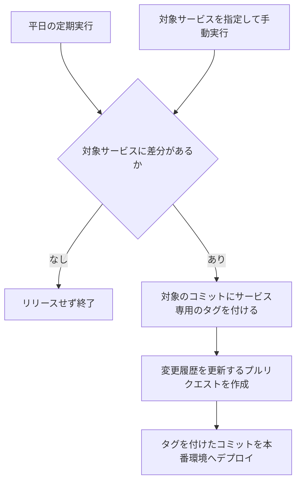

+++
title = '18サービスの一斉リリースを半年かけて解体した'
categories = ['tech']
tags = ['monorepo', 'CI/CD']
mermaid = true
+++

## はじめに

副業先ではWebアプリやバックエンドなど、複数のサービスのコードを1つのリポジトリで管理しています。2026年6月末時点では18のサービスをまとめて本番環境へリリースする仕組みでした。半年ほどかけて各サービスを個別にリリースする運用へ移行しました。

副業の限られた時間で進め、9月に切り替えを終えました。自分としては長く取り組んだ改善だったので、紆余曲折も含めて書き残すことにしました。

## 従来のリリース手順

従来は1つのGitHub Releaseの公開をきっかけに、各サービスを本番環境へデプロイしていました。

1. リポジトリ全体で共通のタグを作成する。
2. そのタグを使ってGitHub Releaseを公開する。
3. 公開をきっかけに、各サービスのワークフローが本番環境へのデプロイを始める。

公開時に対象サービスを指定する手順や、前回からの差分を確認する処理はありませんでした。

## 課題

一斉リリースでは緊急修正の対象をサービス単位で指定できませんでした。たとえば週末にバックエンドを修正しても、Webアプリの検証が終わるまで待てば不具合への対応が遅れます。バックエンドの修正をすぐにリリースすれば、ステージングで検証中のWebアプリの変更まで本番環境へ反映される仕組みでした。

定期リリースでは前回から変更のないサービスも再デプロイしていました。このため、更新が必要なサービスだけをデプロイする仕組みが必要でした。

## 改善内容

### 方針

平日の定期リリースには、日頃から変更を本番環境へ反映できる状態を保つ目的がありました。緊急修正で検証中の変更を巻き込まないよう、定期実行の頻度を保ったままデプロイをサービス単位に分ける方針を立てました。

新しいリリース手順の要件は次の4点です。

- 日頃からリリース可能な状態を保つため、平日の定期リリースを維持する。
- 不要な再デプロイを避けるため、定期実行では差分があるサービスだけをデプロイする。
- 次の営業日や別サービスの検証完了を待たずに修正を出すため、緊急時は対象サービスを指定して手動でリリースする。
- 各サービスの本番環境へ反映した変更を確認するため、変更履歴をサービス単位で管理する。

### リリース手順

GitHub Actionsではサービスごとにリリース処理が動きます。定期実行と手動実行は、どちらも前回のリリースからの差分を確認します。

緊急時は平日の定期実行を待たずに対象サービスの手順を開始できます。

### 設計時に考慮したこと

#### バージョン表記

リリース手順を設計する際、バージョン番号の先頭を西暦の下2桁にする案が出ました。先頭の数字はサービス開始からの年数を表していましたが、私は西暦の下1桁だと受け取っていました。ほかのプロダクトとの表記をそろえる必要があったため、今回の移行では従来の形式を維持しました。

#### リリース用ブランチの差分判定

一部のサービスではリリース用ブランチから修正版を出します。変更履歴を作る処理はほかのサービスと共有しつつ、前回のリリースは同じ系列の中だけで探します。古い系列の修正版を出すときも、新しい系列のタグが差分の起点になることはありません。

### サービスごとに変更履歴を残す

一斉リリースではGitHub Releasesの自動生成ノートで全体の変更を確認していました。サービス別のタグを作る案が出たとき、従来と同じ方法でリリースノートを自動生成できるかが論点になりました。

たとえば、同じ日に2つのサービスをリリースしても、それぞれの前回のリリース日は異なり得ます。各サービスの前回のタグを指定すれば比較の起点は決まります。ただし、その期間のコミットには別サービスの変更も含まれます。

要件を整理する中で、従来のリリースノートがどの変更をいつリリースしたかを確認するための記録だと分かりました。その用途なら、リリースごとの変更を時系列で残せば足ります。

変更履歴の要件は次のとおりです。

- サービスごとにリリースを時系列で確認できること。
- 各バージョンに含まれるプルリクエストを確認できること。

### 変更履歴の生成

サービス別の履歴を作るには、どの変更をどのサービスの履歴へ載せるかを決める必要があります。開発時に変更内容をファイルへ記録する方法と、リリース時にGitの履歴から変更を集める方法があります。まず、変更内容を事前に記録する方法を試しました。

#### Changesetsの検討

Changesetsでは変更内容とバージョンの上げ幅を記したファイルをコミットし、リリース時にまとめて反映します。pnpmのドキュメントに利用例があり、以前にOSSへコントリビュートした際にも使った覚えがあったため、候補に挙げました。

非公開のモノレポを検証用に用意し、コミットしたファイルからリリースの記録を作成できることを確認しました。ファイルを手元で作るほか、プルリクエストのマージ前やマージ時に追加する運用も考えました。ただ、開発者がファイルを作ってコミットする手順を増やすほどの利点は感じませんでした。バージョンの上げ幅で変更の種類を伝える必要が薄い対象では、日付を使ったバージョン管理も候補に挙がりました。

#### git-cliffの採用

<!-- 執筆メモ: Googleのrelease-pleaseも候補だったか、当時の記録を確認する。 -->

変更履歴の生成ツールとしてgit-cliffを採用しました。

https://git-cliff.org/

git-cliffはGitのコミット履歴を読み取り、タグで指定した範囲の変更を集計します。対象のファイルやディレクトリを指定すると、集計する変更も絞り込めます。この2つの条件を組み合わせてサービス別の履歴を作り、各変更に対応するプルリクエストも記録しました。

最初は外部に配布するパッケージの変更履歴を生成しました。本番環境で動くサービスへ展開する際は、過去の共通タグを使って一斉リリース分の変更履歴もサービスごとに作りました。

## 段階移行

配布用パッケージで自動リリースと変更履歴の生成を始め、その後、本番環境で動くサービスを1つずつ切り替えました。移行が済んだサービスは個別の手順でリリースし、残りは従来どおり共通のタグでリリースしました。

### リリース対象の内訳

フロントエンドとAPIなど、デプロイや配布の手順が分かれている対象をそれぞれ1件と数えました。6月末の列は一斉リリースで本番環境へ反映していた対象です。9月末の列は個別リリースの手順を整備した対象です。

| 種類 | 6月末の一斉リリース対象 | 9月末の個別リリース対象 |
| --- | ---: | ---: |
| Webアプリのフロントエンド | 8 | 8 |
| APIなどのサーバー側サービス | 10 | 11 |
| ストアで配信するアプリ | 0 | 1 |
| コマンドラインツール | 0 | 2 |
| 開発者向けのライブラリ（SDK） | 0 | 1 |
| 合計 | 18 | 23 |

コマンドラインツールやSDKなどは別の手順で配布していたため、6月末の18件には含まれません。9月末の集計にはこれらも含めています。配布した変更を同じ形式で確認できるよう、変更履歴をそろえたためです。

## 移行中の課題

### リリース用プルリクエストの手動マージ

配布用パッケージの運用を始めると、リリース用のプルリクエストが作成されたあと、手動でマージする作業が残りました。当時はリポジトリ全体の運用も変わり、既存の承認ラベルでは自動マージが有効にならなくなっていました。

そこで、承認と自動マージを別々のラベルで指定するようにしました。リリースの準備処理では両方のラベルを付けます。承認だけが必要なプルリクエストでは、承認のラベルだけを使います。また、ボットが作成したという理由でAIレビューが走っていたため、レビューが必要な場合にだけ専用のラベルを付ける運用に変えました。

### 変更履歴の生成に約133秒

当初試したgit-cliffのGitHub連携では、変更履歴を作るたびにリポジトリ全体の情報を取得していました。配布用パッケージの1つで計測すると、2コミット分と35コミット分のどちらも約133秒かかりました。

そこで、変更履歴に載せるコミットを先に絞り、その範囲だけGitHub APIでプルリクエストを調べるようにしました。2コミットでは1.8秒、35コミットでは28.2秒になりました。

### チェックアウトに約97秒

変更履歴を生成する前のチェックアウトにも約97秒かかっていました。そのうち約92秒はGit履歴と過去のファイル内容を取得する時間でした。変更履歴の生成で使うコミット履歴は取得し、過去のファイル内容は最初の取得から外しました。

当時のgit-cliff 2.13系は、コミットごとの統計を計算するときにファイル内容を参照するため、この設定ではエラーになりました。そこで、動作を確認できた2.12.0を使いました。変更後のパッチリリースでは、変更履歴の生成ステップは6秒でした。

## 苦労したこと

### 既存のワークフローの把握

WebのフロントエンドやAPIでデプロイの手順が異なっており、Kubernetes向けのワークフローもありました。切り替えを進めるには、それぞれのワークフローを読んで、どの処理を変更するか判断する必要がありました。既存のリリースへの影響も考えながら、幅広い対象のワークフローを慎重に変更していく作業に苦労しました。

### ワークフローの動作確認

リリース用のGitHub Actionsは動作確認が難しかったです。ローカルのエミュレーターだけではGitHub上での挙動まで確認できません。一方、GitHub上で試すと、タグの作成や本番環境へのデプロイが起こり得ます。

序盤は、試しに実行しただけで既存のリリースへ影響しないよう、処理ごとの実行条件を慎重に確認しました。その分、ワークフローの実装に時間がかかりました。デプロイ後も意図したとおりに動くか、数日ほど様子を見てから次の対象へ進みました。

実際に配布用パッケージのリリース準備が失敗したときは、Slackの通知を受けて修正し、手動で再実行しました。

## おわりに
